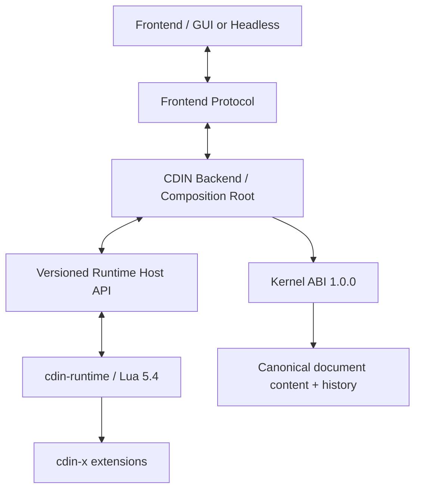

# Runtime architecture

## Position in the system

`cdin-runtime` is the Lua policy/application layer. CDIN Backend is the host provider and composition root; the Kernel is reached **through the Backend-provided Runtime Host API**, never by linking the Kernel from Lua or by embedding a second Kernel.

## Runtime-owned modules

- `commands/`: command registration and dispatch.
- `input/`, `keymaps/`: key normalization and policy resolution.
- `config.lua`, `project.lua`, `themes.lua`, `style.lua`: configuration and logical style roles.
- `plugins.lua`: extension loading contract, not the extension ecosystem itself.
- `syntax/`, `doc/highlighter.lua`: syntax metadata and highlighting policy.
- `views/`, `rootview/`, `state.lua`: logical UI model, selections, view tree and status/prompt surfaces.
- `doc/`: the target is a thin client of the Kernel via Host API; current `doc/init.lua` remains a transitional legacy implementation.

## Non-responsibilities

No SDL/renderer drawing, window lifecycle, OS filesystem implementation, native Lua C binding, Kernel implementation, C ABI structs, backend event loop or canonical document/history store should be added here.

## Modularity rules

1. Core policy modules should accept tables/callbacks at boundaries rather than read process globals wherever a practical seam exists.
2. Keep existing `core.*` module paths while extracting; path renames are a separate migration.
3. New utility modules must not require `core.init`, SDL, renderer globals or the Kernel implementation.
4. Cross-module registrations should be explicit; use `core.runtime.registry` where a generic registry is appropriate.
5. Errors at host boundaries use `{ code, message, details }`; branch on `code`, never the message.
6. Keep the Lua state on its owner thread. Background workers may post host events but must not access the Lua state directly.
7. A view may own selection and scroll metadata; only Kernel owns authoritative document bytes/version/history.

## Current reality vs target

The copied CDIN core predates the standalone Kernel integration. This initial repository preserves it to keep the extraction inspectable and testable; see [migration status](migration-status.md) before treating any target rule as implemented.
