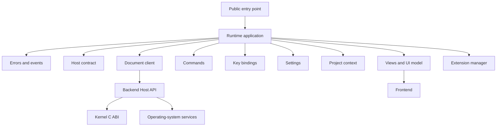

# Module boundaries

This page explains where a change belongs. The Runtime is intentionally split
into small modules so that a command does not need to know how a document is
stored, and a view does not need to know how a window is drawn.

## How modules connect

The diagram shows ownership, not a claim that every connection is already
implemented. The production Backend adapter and Frontend connection are still
work to do.

## Where should code go?

| If the code needs to... | Put it in... | Keep it away from... |
| --- | --- | --- |
| report an error or publish an internal event | `core/` | document policy, UI and Host implementation |
| check versions and required services | `host/` | native Kernel calls |
| read or change a document | `document/` | UI layout, filesystem implementation and direct C calls |
| handle a named editor action | `command/` | window drawing and operating-system calls |
| translate a raw key into a command | `input/` | frontend-specific key handling and Backend transport |
| validate settings or keep project context | `config/`, `workspace/` | global mutable state and direct disk access |
| track views, selection, focus or style roles | `presentation/` | drawing, font shaping, pixel coordinates and canonical text storage |
| load extension code and clean up its contributions | `extension/` | unrestricted globals and private Backend/Kernel objects |
| connect the modules and own start/stop | `application.lua` | direct use of native Kernel APIs |

## The important boundaries

- **Runtime → Backend:** a provisional Lua Host API. Runtime requests document
  operations and publishes semantic UI state through this interface.
- **Backend → Kernel:** the public C ABI `1.0.0`. Only Backend code adapts this
  ABI; Runtime modules must not import it directly.
- **Frontend ↔ Backend:** the Frontend Protocol. The wire format and full
  integration are not implemented in this repository yet.
- **Extension → Runtime:** the provisional Lua Extension Contract. Extensions
  receive an explicit capability facade rather than private internals.

## Logical panes are not visual layout

Runtime may keep a tree that says which views are next to each other. That is
logical editor state. The tree does not contain pixel rectangles, font metrics,
line wrapping, bidirectional text layout or draw calls. Each Frontend decides
how to display the same logical model in its own environment.

The [CDIN Specification](https://github.com/cdin-editor/spec) defines the
cross-repository architecture and takes priority over this implementation map.
