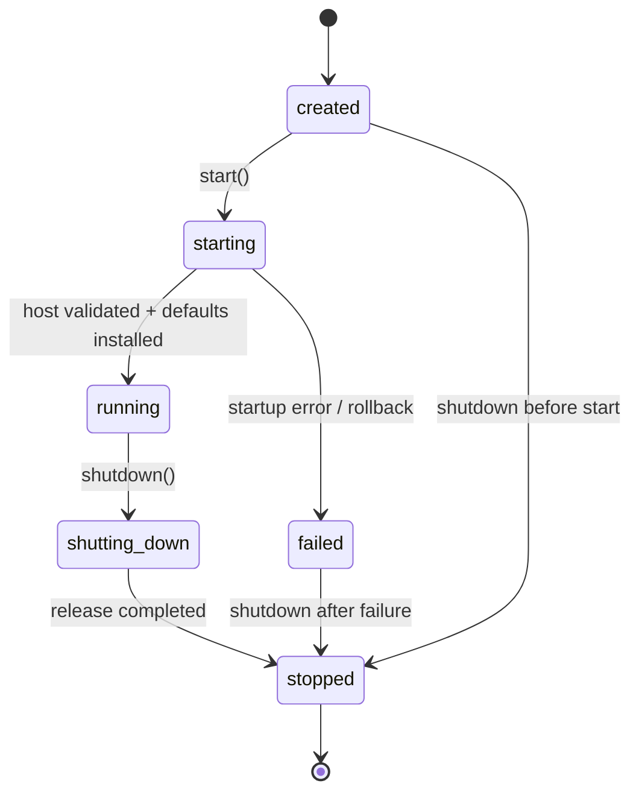

# Errors and lifecycle contracts

## Error object

Errors crossing runtime module boundaries use the following shape:

```lua
{
  domain = "cdin.runtime",
  code = "HOST_API_MISMATCH",
  message = "required host capability is unavailable",
  details = { capability = "snapshots" },
  context = "optional operation context",
}
```

`code` is stable and suitable for branching. `message` is for diagnostics and
may change. `details` contains machine-readable fields; `context` is optional.
Runtime errors include `HOST_API_MISMATCH`, `BAD_EXTENSION`,
`DUPLICATE_REGISTRATION`, `NOT_FOUND` and `PERMISSION_DENIED`, in addition to
Kernel ABI-aligned statuses listed in the Host API contract.

Callers should use `error.is(value)` and `error.normalize(value, fallback, context)`
instead of inspecting strings. Protected callback boundaries normalize unknown
errors to `INTERNAL`; they must retain the root cause when possible.

## Runtime state machine



A failed startup is not partially usable. A stopped runtime cannot restart;
create a new Runtime instance instead. Public operations check lifecycle state
and fail with `INVALID_STATE` or `SHUTDOWN`.

## Resource states

- **Document client:** `open → closing → closed`; opaque handles are invalidated
  even if cleanup reports an error, so they are never reused.
- **Snapshot:** `open → closing → closed`; explicit `close()` is the primary
  release path. `with_snapshot(callback)` releases even if the callback throws.
- **Transaction:** `active → committed` or `active → aborted`; repeat finalization
  is rejected or returns `false` as documented by the operation.
- **Extension:** `active → unloaded`; owner-bound registry entries are removed
  during rollback or explicit unload.

## Threading

Lua state access is single-threaded. Backend worker threads may not call Lua or
mutate Runtime objects. A Kernel wakeup callback may only notify the Backend
loop, which schedules a pump on the Lua owner thread. No Runtime API implies a
background coroutine scheduler or FIFO write queue.
